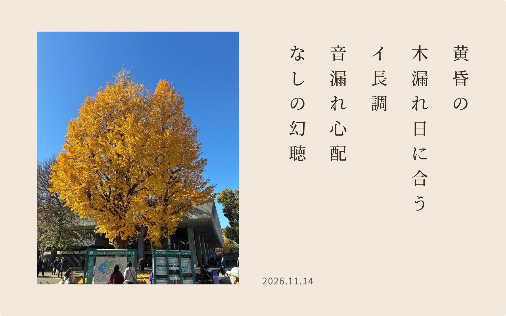

<a href="https://cocoa-he.art">
  <picture>
    <source media="(prefers-color-scheme: dark)" srcset="https://raw.githubusercontent.com/motoshifurugen/motoshifurugen/output/tanka-dark.png">
    <source media="(prefers-color-scheme: light)" srcset="https://raw.githubusercontent.com/motoshifurugen/motoshifurugen/output/tanka-light.png">
    
  </picture>
</a>

<p align="center">Code, photographs and tanka from Okinawa.</p>

```typescript
const motoshi: SoftwareEngineer = {
  base:       "Okinawa, Japan",
  philosophy: "Shaping invisible data, much like physics decodes nature.",
  vision:     "Delivering exciting UX via design & art.",
  priority:   "Healthy mind, healthy code.",
};
```

<p align="center">
  <a href="https://furugen-island.com/my_site">Portfolio</a>
  &nbsp;·&nbsp;
  <a href="https://zenn.dev/motoshifurugen">Zenn</a>
  &nbsp;·&nbsp;
  <a href="https://note.com/cocoa_hearts21">note</a>
  &nbsp;·&nbsp;
  <a href="https://twitter.com/cocoahearts21">X</a>
</p>
